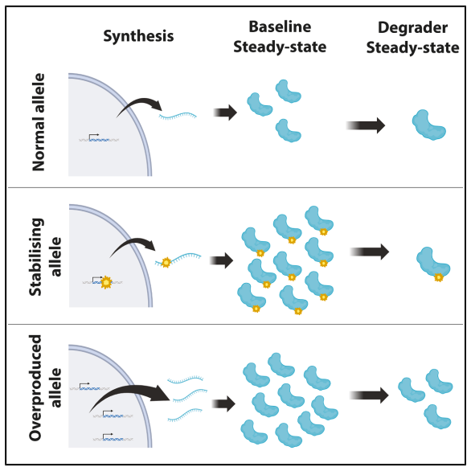

::: {.article-type}
PAPER ANALYSIS · 8 MIN READ
:::

::: {.article-deck}
High target abundance can result from slow clearance or fast production. A degrader may overcome the first while leaving a larger residual protein pool in the second. Earlier turnover models already explain this behavior. The question is what the new experiment adds.
:::

{.article-cover fig-alt="Graphical model comparing normal, stabilizing, and overproduced alleles before and after degrader treatment"}

## What this paper adds

Gudauskaitė and colleagues studied how two routes to high β-catenin expression affect induced degradation. Cancer-associated mutations that stabilize β-catenin raised its baseline abundance, yet dTAG treatment drove the mutant and wild-type proteins toward similar residual levels. Increasing transcription produced a different result: protein abundance remained higher both before and after treatment. [1](#ref-gudauskaite)

My initial reaction was that the main conclusion is not especially new. Protein-turnover models already predict that changing synthesis and changing intrinsic degradation will have different effects under degrader treatment. The authors recognize this connection and cite earlier modeling work, including Bartlett and Gilbert's 2022 review. [2](#ref-bartlett)

The paper still adds useful evidence. It tests both routes to overexpression in a controlled cellular system and shows why percentage degradation can be misleading. For drug development, the amount of functional protein left after treatment may matter more than the percentage removed.

## Two routes to high β-catenin expression

The authors fused β-catenin to FKBP12 F36V and GFP. The dTAG compounds recruit an E3 ligase to the FKBP12 tag, while GFP provides a readout of target abundance. Each construct was integrated at the same genomic landing site in engineered 293 cells, reducing differences in expression context that would complicate a comparison across unrelated cell lines. [1](#ref-gudauskaite)

Three cancer-associated mutations, S45F, T41A, and S33F, raised baseline reporter abundance by approximately threefold, fourfold, and fivefold. These mutations impair the native degradation pathway. After recruitment of either VHL or CRBN, the large pretreatment differences narrowed, and the proteins approached similar residual levels during prolonged treatment, including the 24-hour measurements at 100 nM.

The authors then used a doxycycline-inducible system to increase production. Doxycycline raised pretreatment protein expression approximately 2.4-fold for wild-type β-catenin and 4.9-fold for S45F. After 24 hours of dTAGv1 treatment at 100 nM, Figure 4G shows approximately 3.3-fold and 4.7-fold higher residual signals in the induced cells. The fractional depletion was similar with and without induction. [1](#ref-gudauskaite)

The paper calls these “absolute” protein levels, but the measurement is background-corrected GFP fluorescence rather than calibrated molecules per cell. The comparison is valid within the reporter system. It does not establish how much β-catenin would remain in a tumor or whether that amount would sustain signaling.

## The model predicts the result

Bartlett and Gilbert's 2022 review discussed quantitative PK-PD frameworks for protein degraders. Haid and Reichel's 2023 framework made the relationship among target engagement, endogenous turnover, and induced degradation explicit. Their Equation 8 uses the indirect-response formulation also discussed by Bartlett and Gilbert. [2](#ref-bartlett), [3](#ref-haid)

Using the notation from my earlier [degradability analysis](../2026-09-11-degradability-landscape-protein-degraders/index.qmd), the protein balance is:

$$
\frac{dP}{dt}=k_{sp}-k_{dp}P-k_{cat}[PLE].
$$

Here, $k_{sp}$ is the synthesis rate, $k_{dp}$ is the endogenous first-order loss constant, and $k_{cat}[PLE]$ is the induced degradation flux through the target-degrader-E3 complex.

For intuition, assume that synthesis and exposure are constant and that the E3 ligase is not saturated. If ternary engagement, $TE=[PLE]/P$, is approximately constant, then $k_{ind}=k_{cat}TE$ and:

$$
P_0=\frac{k_{sp}}{k_{dp}},
\qquad
P_{ss,drug}=\frac{k_{sp}}{k_{dp}+k_{ind}}.
$$

These equations are a simplified interpretation, not a fit to the paper's data. They are useful because they separate two ways of reaching the same high baseline.

A stabilizing mutation lowers $k_{dp}$. If synthesis is unchanged, the baseline rises. When induced degradation is much faster than endogenous turnover, the treated level approaches $k_{sp}/k_{ind}$ and becomes relatively insensitive to the original half-life. This explains why the stabilized mutants can approach the wild-type residual level.

The convergence is approximate. With the same finite $k_{ind}$, the model still predicts somewhat more residual protein when $k_{dp}$ is lower. The result fits a kinetic regime in which induced degradation dominates endogenous turnover. It does not show that stabilization can never affect the residual level.

Increasing synthesis changes the numerator instead. If synthesis rises fivefold while both loss constants remain unchanged, the model predicts fivefold more protein before and after treatment. This is the pattern seen in the inducible system. It does not require saturation of the E3 ligase or proteasome.

## Why Dmax can mislead

Under the same assumptions, fractional steady-state depletion at a specified exposure is:

$$
D_{ss}=1-\frac{P_{ss,drug}}{P_0}
=\frac{k_{ind}}{k_{dp}+k_{ind}}.
$$

The synthesis term cancels. More synthesis raises the amount of protein remaining without necessarily changing the fraction removed. $D_{max}$ is the greatest depletion observed across the tested conditions, so a finite-time experimental $D_{max}$ should not automatically be treated as the steady-state value in this equation.

Consider a simple calculation with synthesis of 100 arbitrary protein units per hour, endogenous loss of 1 per hour, and induced loss of 4 per hour:

| Model condition | Baseline protein | Treated steady state | Fraction removed |
|---|---:|---:|---:|
| Reference | 100 | 20 | 80% |
| Fivefold higher synthesis | 500 | 100 | 80% |
| Fivefold lower endogenous loss | 500 | About 24 | About 95% |

These are calculated examples, not experimental measurements. The two overexpressing conditions begin with the same amount of protein but finish at very different levels. The stabilization condition also produces a larger percentage reduction because its endogenous loss rate is lower.

An 80% $D_{max}$ does not identify a unique post-treatment protein level. A 95% $D_{max}$ in one cell and 80% in another also does not prove that the first cell has a more efficient ubiquitin-proteasome system. Different endogenous turnover rates can change the percentage even when the induced degradation rate is the same.

The residual levels will not always converge. If the induced loss constant in the example were only 1 per hour, fivefold stabilization would leave about 83 units rather than 50 units in the reference condition. The common floor reported in this paper depends on induced degradation being strong relative to endogenous turnover.

Haid and Reichel similarly found that baseline target abundance has little effect on fractional degradation in their unsaturated approximation. That conclusion does not make abundance irrelevant. Baseline abundance can cancel from a normalized response while still determining how much protein remains. [3](#ref-haid)

## What the study does not show

Equations cannot tell us whether their assumptions will hold in a cell, where a mutation may change localization or accessibility and high expression may strain the degradation machinery. This is where the paper earns some credit. Similar results with VHL-recruiting and CRBN-recruiting dTAG compounds make the experimental finding more convincing.

Still, both compounds recruit ligases through an engineered FKBP12 tag. The study does not test whether a therapeutic degrader binding native β-catenin would maintain the same target engagement and productive ubiquitination across these variants.

The experiment also does not demonstrate degrader resistance. Increased synthesis left more reporter protein after treatment, but the authors did not show that the residual pool maintained Wnt signaling, cell growth, or tumor survival. Doxycycline induction models increased expression; it is not evidence that gene amplification arose under degrader selection.

I see this paper as a validation study rather than a new mechanistic framework. It gives experimental support to a point already present in the modeling literature: high baseline abundance has to be separated into synthesis and turnover, and $D_{max}$ should be interpreted together with the amount of target remaining. Until residual protein is linked to persistent pathway activity, the proposed connection to drug resistance remains a hypothesis.

::: {.evidence-note}
### Evidence note

The experimental systems, fold changes, treatment conditions, and reporter outcomes come from Gudauskaitė and colleagues. I derived the equations and illustrative table under assumptions of constant synthesis, first-order loss, steady state, and unsaturated, constant engagement. The assessment of conceptual novelty and the interpretation of the resistance claim are my own.
:::

## References

[]{#ref-gudauskaite}

1. Gudauskaitė E, Hernández-Morán B, Taylor GCA, Wood AJ. Oncogene activation mechanism determines the limits of targeted protein degradation. *Cell Chemical Biology*. 2026. [Paper](https://doi.org/10.1016/j.chembiol.2026.08.006).

[]{#ref-bartlett}

2. Bartlett DW, Gilbert AM. Translational PK-PD for targeted protein degradation. *Chemical Society Reviews*. 2022;51:3477-3486. [Publisher](https://doi.org/10.1039/D2CS00114D); [abstract](https://pubmed.ncbi.nlm.nih.gov/35438107/).

[]{#ref-haid}

3. Haid RTU, Reichel A. A Mechanistic Pharmacodynamic Modeling Framework for the Assessment and Optimization of Proteolysis Targeting Chimeras (PROTACs). *Pharmaceutics*. 2023;15:195. [Full text](https://pmc.ncbi.nlm.nih.gov/articles/PMC9865105/). See Equations 8-15 and the discussion of target abundance and saturation.

::: {.article-disclosure}
**Article history:** First published September 16, 2026. No substantive corrections.

**Figure credit:** Graphical abstract from Gudauskaitė et al. (2026), reproduced under the [Creative Commons Attribution 4.0 license](https://creativecommons.org/licenses/by/4.0/).

**Editorial disclosure:** Prepared with AI assistance and reviewed by the author.
:::

  <a href="https://www.linkedin.com/sharing/share-offsite/?url=https%3A%2F%2Fichunglo.github.io%2Fposts%2F2026-09-16-oncogene-activation-degrader-response%2F" target="_blank" rel="noopener noreferrer">Share on LinkedIn</a>
  <a href="mailto:ichunglo@protonmail.com?subject=The%20Edge%20of%20Evidence">Email iLo</a>

