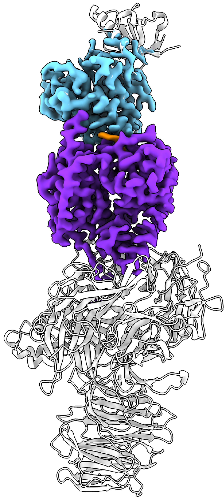
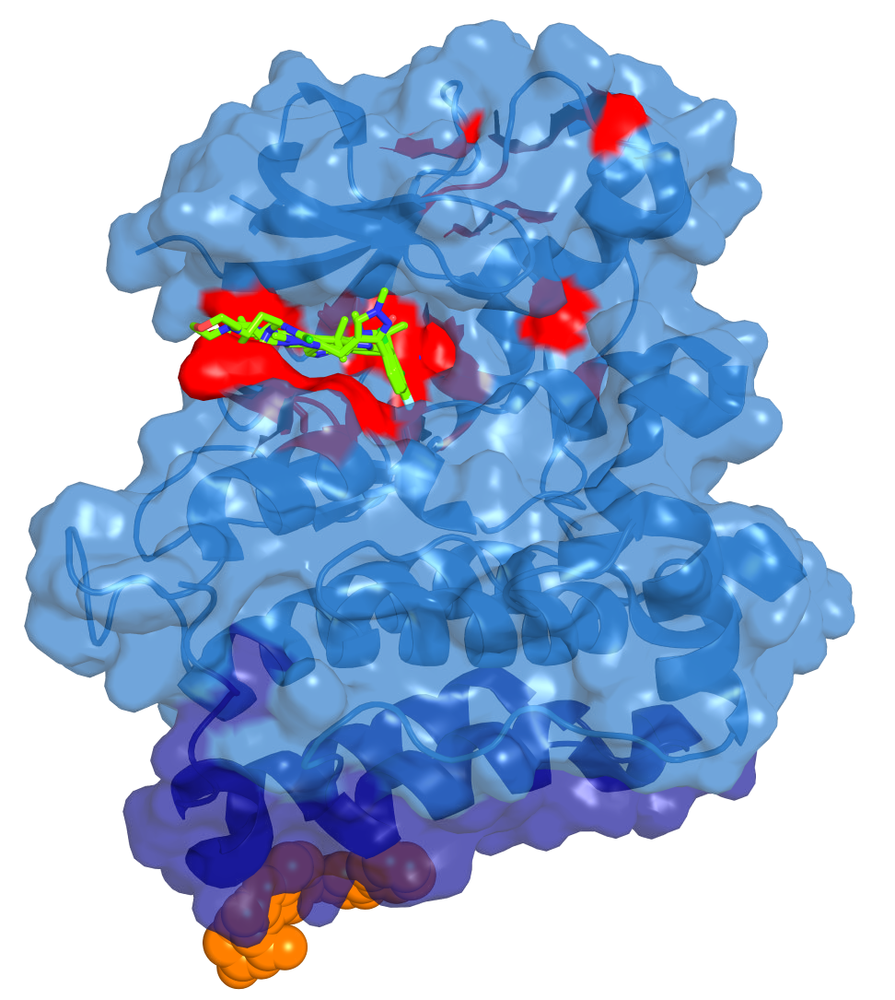
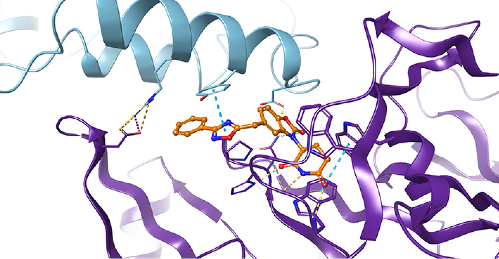

::: {.article-type}
PAPER ANALYSIS · 8 MIN READ
:::

::: {.article-deck}
TRI-611 is a strong model paper for molecular-glue discovery: it identifies a brain-penetrant CRBN glue that degrades ALK through a non-orthosteric turn–helix degron, overcomes ALK TKI resistance in preclinical models, and can be combined with kinase inhibition. The study also shows why molecular-glue discovery remains difficult to make predictable.
:::

## The central result

ALK-positive cancers have benefited enormously from tyrosine kinase inhibitors (TKIs), especially lorlatinib. But resistance mutations accumulate around the kinase active site, CNS disease remains important, and inhibitors that compete for the same orthosteric pocket cannot easily be combined.

The study by Conery and colleagues presents an orthogonal strategy: instead of inhibiting ALK, eliminate it. The authors identify TRI-611, a selective, brain-penetrant molecular glue degrader that recruits ALK to the CRL4–CRBN E3 ligase.

## A model molecular-glue workflow

The authors screened 4,827 compounds designed to bind CRBN using TR-FRET to detect compounds that induce proximity between CRBN and the ALK kinase domain. The initial hit, Compound 1, induced proximity but did not yet degrade ALK. Medicinal-chemistry optimization ultimately produced TRI-611.

The final molecule was validated through multiple complementary approaches: TR-FRET, surface plasmon resonance, cellular NanoBiT assays, ubiquitination studies, proteomics, CRBN knockout, structural biology, cellular pharmacology, and in vivo PK/PD and efficacy studies.

This progression is important. A molecular glue is not simply a compound that binds two proteins. It must create a productive ternary complex with the right geometry, cooperativity, and ubiquitination orientation.

TRI-611 induced rapid and deep degradation of ALK fusion proteins. ALK levels fell by approximately 90% within one to two hours, and degradation required CRBN, neddylation, and the proteasome. Proteomic profiling showed strong selectivity across the tested cell lines, including no significant degradation of related kinases such as ROS1 or the NTRK family.

## A new degron outside the kinase active site

The structural centerpiece is a 2.7 Å cryo-EM structure of the ALK–TRI-611–CRBN complex.

{fig-alt="Cryo-EM structure of the ALK–TRI-611–CRBN ternary complex"}

{fig-alt="ALK inhibitor binding sites, resistance mutations, and the TRI-611 interaction footprint"}

{fig-alt="Molecular interactions at the ALK–TRI-611–CRBN interface"}

*Figure 2 from Conery et al. The three panels are shown separately for readability: the ternary complex, the spatial relationship between the glue interface and TKI resistance mutations, and the key molecular contacts. Reproduced from the supplied paper for commentary and analysis; structural coordinates are deposited as PDB 9XZG.*

Unlike a PROTAC, TRI-611 does not use a long flexible linker to connect two independently binding ligands. Instead, it creates a chemically shaped surface that is complementary to both proteins.

TRI-611 engages the C-lobe of the ALK kinase domain, far from the ATP-binding site. Key interactions include contacts involving ALK Tyr1385, Arg1382, and Asp1389. The authors describe this recognition element as a previously undescribed “turn–helix degron,” distinct from the better-known CRBN G-loop and G-loop-like degrons.

This expands the structural landscape of CRBN recognition. It suggests that molecular-glue discovery need not be limited to proteins containing obvious canonical degrons.

## Why TRI-611 can overcome ALK TKI resistance

Most clinically important ALK resistance mutations affect the kinase active site or its surroundings. Because TRI-611 engages a separate surface, mutations such as L1196M, G1202R, I1171N, and compound resistance mutations do not necessarily prevent degradation.

The authors tested TRI-611 in engineered Ba/F3 models, endogenous CRISPR-edited NCI-H3122 cells, and patient-derived cell lines. TRI-611 retained activity across a broad panel of ALK variants and was particularly more potent than lorlatinib in models derived from patients who had progressed on lorlatinib.

The in vivo results were similarly strong. TRI-611 induced regression in subcutaneous xenografts containing resistant ALK variants, including L1196M/G1202R. It also produced dose-dependent responses in intracranial models, including tumors carrying the same lorlatinib-resistant mutation.

This is one of the strongest aspects of the study: the structural hypothesis is connected directly to resistant cellular models, patient-derived models, tumor pharmacodynamics, and CNS efficacy.

## Combining degradation with inhibition

Because TRI-611/CRBN and ALK TKIs engage different regions of the kinase domain, the two mechanisms should be compatible. The authors report that TRI-611–CRBN engagement does not alter ALK enzyme kinetics and that ALK TKIs retain activity when ALK is in the TRI-611–CRBN complex.

The combination therefore raises an interesting mechanistic question. Does TRI-611/CRBN binding have any effect on ALK kinase activity under conditions in which neddylation is blocked by MLN4924? Such an experiment could separate formation of the ternary complex from activation of the CRL4–CRBN degradation machinery. It would also clarify whether the glue-bound complex itself changes ALK conformation or catalytic behavior.

Similarly, does TRI-611/CRBN binding alter the biochemical potency or residence time of lorlatinib? The available data suggest that it does not prevent orthosteric inhibition, but a more detailed biochemical analysis would establish whether the two ligands are entirely independent or subtly influence one another.

In cells, TRI-611 shifted the lorlatinib dose-response curve and produced greater-than-additive growth inhibition at partially active concentrations. In mouse models, subefficacious doses of the two agents produced tumor regression, and combination treatment delayed tumor regrowth after dosing stopped.

The latter result is consistent with deeper or more durable tumor control, although delayed regrowth alone does not prove that more tumor cells were permanently eliminated.

## Molecular-glue discovery remains highly serendipitous

The authors identified a productive CRBN-based glue by screening 4,827 CRBN-binding compounds for ALK–CRBN proximity, even though ALK did not contain an obvious canonical G-loop degron. The probability of finding such a molecule cannot be calculated from this study alone, but the success rate for discovering a functional glue against a specific target is generally expected to be low.

There is also a fundamental limitation to the screening format. TR-FRET requires purified protein, yet full-length purified proteins are often difficult or impossible to obtain. Researchers may therefore need to screen individual domains or engineered constructs.

If the relevant degron is absent from the purified domain, depends on a fusion partner, is exposed only in a particular conformational state, or requires a native protein environment, a genuine molecular glue may not produce a screening signal. A negative screen may therefore reflect limitations of the protein construct rather than the true inability of the target to form a productive degrader complex.

TRI-611 is an excellent success story, but it does not make this discovery process predictable. It shows that unusual degrons can be found; it does not tell us where the next one will come from.

## What remains unresolved

The selectivity data are impressive, but they do not completely exclude lineage-specific degradation in other human tissues. This is particularly important for SALL4, a CRBN neosubstrate associated with teratogenic biology.

SALL4 is probably absent or expressed at very low levels in the cell lines used for the proteomic experiments. Consequently, the absence of SALL4 degradation in those datasets cannot be interpreted as evidence that TRI-611 will not degrade SALL4 in human tissues where SALL4 is expressed.

For a CRBN molecular glue, this is a major development question. A stronger safety package should include quantitative proteomics in additional differentiated and primary human cell types, SALL4-specific degradation assays, developmental and reproductive toxicity models, and broader evaluation in tissues with relevant CRBN-neosubstrate expression.

TRI-611 may also avoid classical TKI-resistance mutations while creating a resistance surface of its own. Mutations that disrupt the ALK–TRI-611–CRBN interface could theoretically preserve ALK kinase function while preventing degradation. Chronic resistance-selection studies will be important.

## Final perspective

The most important contribution of this study is not simply that TRI-611 shrinks ALK-positive tumors. Several ALK inhibitors can do that.

The deeper contribution is that an oncogenic kinase fusion can be eliminated by a brain-penetrant molecular glue through a non-orthosteric structural degron. That mechanism bypasses many classical active-site resistance mutations and permits simultaneous kinase inhibition and protein degradation.

TRI-611 is therefore both a promising therapeutic concept and a model discovery story. It shows what a complete molecular-glue program can achieve, while also showing how much of the initial discovery process still depends on finding the right protein construct, conformational state, E3 ligase, and chemical geometry.

## Reference

Conery AR et al. “TRI-611, a selective, brain-penetrant molecular glue degrader of ALK.” *Nature*. 2026. PDB: [9XZG](https://www.rcsb.org/structure/9XZG).

::: {.article-disclosure}
**Article history:** First published October 25, 2026.

**Figure credit:** Figure 2 from Conery et al. (2026), reproduced from the supplied paper for commentary and analysis.

**Editorial disclosure:** Prepared with AI assistance and reviewed by the author.
:::
